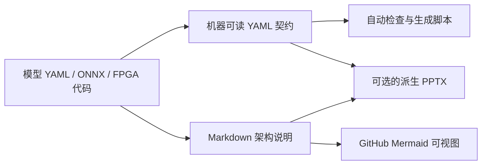
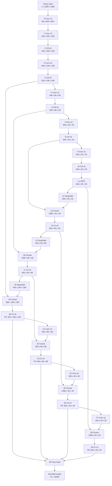
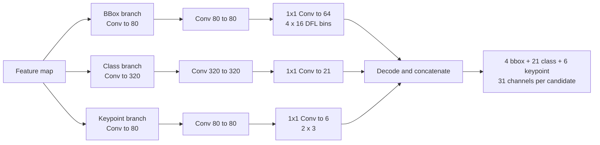

# Pose21 Gray1 网络架构与 FPGA 适配说明

> 文档状态：草案，供模型、量化和 FPGA 联合评审  
> 更新日期：2026-09-23  
> 当前模型：21 类 Gray1 YOLOv8x-Pose-P6，输入 `[1,1,1280,1280]`  
> 历史 PPT 已由用户另行备份，本目录不再保存二进制副本  
> 机器可读参数：[pose21_gray1_fpga_contract.yaml](pose21_gray1_fpga_contract.yaml)

## 1. 文档组织原则

PPTX 适合讲解和拖拽编辑，但二进制文件不利于 Git diff、代码评审、全文检索和大模型稳定解析。本目录采用以下分层：



- **事实源**：模型 YAML、冻结权重、ONNX 图、FPGA RTL/驱动和 BIN 生成代码。
- **机器契约**：YAML 保存 shape、dtype、对齐方式、状态和证据位置，便于脚本与大模型读取。
- **人工说明**：Markdown 保存设计原因、图、变更表、风险和验收结果，Git 可以逐行审计。
- **演示材料**：需要汇报时由前两者生成或同步 PPTX。PPTX 不单独承载唯一事实。
- **图形编辑**：Mermaid 源码是普通文本，可在 GitHub、Mermaid Live Editor 和多数 Markdown 编辑器中修改与渲染。

状态词统一为：

| 状态 | 含义 |
|---|---|
| `verified` | 已由当前模型或当前代码直接验证 |
| `historical` | 只属于旧 WRS/PPT 或旧三通道任务 |
| `provisional` | 当前软件已采用，但尚未获得 FPGA 实机闭环 |
| `inferred` | 根据多份证据推导，仍需权威实现确认 |
| `unresolved` | 缺少定义或证据，禁止作为交付假设 |

## 2. 当前模型身份

| 项 | 当前值 | 状态 |
|---|---|---|
| 模型任务 | Pose | `verified` |
| 权重 | `best.pt`，199,108,106 bytes | `verified` |
| SHA-256 | `622cff54db472b61c85db03648b36c119f030eacbd4cd87cf5d2dda67e69d6a7` | `verified` |
| 模型 YAML | `yolov8x-pose-p6-gray1.yaml` | `verified` |
| 实际 compound scale | `x` | `verified` |
| 输入 | `[1,1,1280,1280]`，Gray1，NCHW | `verified` |
| 类别 | 21 | `verified` |
| 关键点 | `[2,3]`，即 2 个 `(x,y,visible)` | `verified` |
| 检测尺度 | stride 8、16、32、64 | `verified` |
| 候选数 | 34,000 | `verified` |
| FP16 ONNX 输出 | `[1,31,34000]` / FLOAT16 | `verified` |

运行名含有 `m_50e`，但当前模型 YAML 明确指定 `scale: x`。模型规模判断必须以 YAML 和实际权重 shape 为准，不能从运行名推断。

## 3. 总体网络架构



表中省略 batch 维，所有 shape 均为 `C x H x W`。当前 FP16 ONNX 包含 148 个 `Conv` 节点，首层权重 shape 已验证为 `[80,1,3,3]`。

## 4. 四尺度 Pose Head

四个尺度使用相同的三分支结构：



| 输入尺度 | Head 输入 | bbox raw | class raw | keypoint raw | 候选数 |
|---|---:|---:|---:|---:|---:|
| P3 / stride 8 | `[1,320,160,160]` | 64 | 21 | 6 | 25,600 |
| P4 / stride 16 | `[1,640,80,80]` | 64 | 21 | 6 | 6,400 |
| P5 / stride 32 | `[1,640,40,40]` | 64 | 21 | 6 | 1,600 |
| P6 / stride 64 | `[1,640,20,20]` | 64 | 21 | 6 | 400 |

解码后逻辑输出布局：

```text
ch 0..3    bbox
ch 4..24   21 class scores
ch 25..30  2 keypoints x (x, y, visibility)
```

FPGA/host 侧当前目标布局为 `[34000][32]` FP16。`ch31` 只用于物理对齐，不能参与分类、阈值、NMS 或关键点解析。

## 5. 从旧 PPT 到当前 Gray1 的变化

| 主题 | 旧 PPT / WRS 版本 | 当前 Gray1 版本 | FPGA 影响 |
|---|---|---|---|
| 输入语义 | R-only 三通道 | 真正单通道 Gray1 | 输入 DMA、buffer、第一层取数和测试向量需要更新 |
| ONNX 输入 | `[1,3,1280,1280]` | `[1,1,1280,1280]` | 第一层逻辑权重由 `[80,3,3,3]` 变为 `[80,1,3,3]` |
| 类别数 | 2 | 21 | 四个分类末端卷积由 2 通道变为 21 通道 |
| 类别 ID | `aituosha=0, moon=1` | 固定 0..20，`aituosha=2, moon=20` | 固件、host 和业务逻辑必须同步类别表 |
| raw class head | 每尺度 2 通道 | 每尺度 21 通道 | 分类头权重、bias、scale 和地址全部变化 |
| raw bbox + class | `[1,66,34000]` | `[1,85,34000]` | split offset 从 64+2 改为 64+21 |
| decoded output | `[1,12,34000]` | `[1,31,34000]` | DMA 输出、NMS offset 和 buffer 长度变化 |
| 物理输出 | 旧版细节分散 | 31 有效通道对齐为 32 | `ch31` 必须清零并被后处理忽略 |
| 主干/颈部 | x 规模、四尺度 P6 | 保持相同总体拓扑 | 大多数层 shape 可复用，但仍须由当前 ONNX 重建清单 |
| 第一层物理对齐 | PPT 显示 `96 x 32 x 3 x 3` | 预计仍为 96 输出 lane、32 输入 lane | 只有 1 个真实输入通道，其余 lane 的填充规则须验证 |
| 模型输出类型 | PPT 未形成独立契约 | FP16 ONNX I/O 已验证 | FPGA 输入和输出接口按 FP16 核对 |
| 量化方法 | PPT 只留下 8 bit 权重线索 | 当前交付为 W8A16 weight-only，激活 FP16 | 激活位宽是否符合 RTL 尚未确认 |

旧 PPT 第 45、46 页中的 `Malloc_Weight(..., 8)` 与当前 BIN 代码共同支持“卷积权重为有符号 INT8”。PPT 没有定义激活位宽、scale、zero-point、累加器、舍入或饱和规则。

## 6. 逻辑 shape 与 FPGA 物理 shape

旧 PPT 已经证明 FPGA shape 不能简单等同 ONNX shape：

| 层/场景 | ONNX 逻辑 shape | 旧 FPGA 物理 shape | 原因 |
|---|---|---|---|
| 第一层权重 | `[80,3,3,3]` | `[96,32,3,3]` | `Tout=32`、`Tin=32` 对齐 |
| 第二层权重 | `[160,80,3,3]` | `[160,96,3,3]` | 输入通道 80 对齐到 96 |
| C2f layer 2 cv1 | `[160,160,1,1]` | PPT 截图显示 `[192,160,1,1]` | chunk/分支物理布局的特殊处理 |
| C2f layer 2 concat 后 cv2 | 逻辑输入 400 | PPT 截图显示物理输入 480 | 5 个 80 通道分支分别对齐为 96 后拼接 |

当前 Gray1 第一层的逻辑 shape 是 `[80,1,3,3]`。如果继续使用 32-lane 输入，建议的物理布局是 `[96,32,3,3]`，其中一个 lane 保存真实权重，31 个 lane 补零。但这是 `inferred`，必须用 RTL/驱动定义和逐层软件仿真确认，不能只按旧 PPT 复制。

## 7. 当前量化状态

当前交付基线是任务 `20260920_063903_Pose21_Gray1_weight-only_accuracy_valida` 生成的 W8A16 weight-only 模型。462 张快速评估结果为：

| 模型 | Precision | Recall | F1 | 任务口径 mAP |
|---|---:|---:|---:|---:|
| PT | 91.4365% | 87.5661% | 89.4595% | 81.1800% |
| Weight-only ONNX | 91.4365% | 87.5661% | 89.4595% | 81.1800% |
| FPGA 输入回环 | 90.7357% | 88.0952% | 89.3960% | 80.9752% |

已确认：

- FP16/weight-only ONNX 输入是 `[1,1,1280,1280]` FLOAT16，输出是 `[1,31,34000]` FLOAT16。
- 最终图包含 148 个 Conv 和 148 个卷积权重 DequantizeLinear；激活 QuantizeLinear/DequantizeLinear 数量为 0。
- 148 组 Conv 权重全部为逐输出通道 QInt8、`axis=0`；激活保持 FP16。
- PT 与 weight-only ONNX 的检测数量和四项汇总指标完全一致，平均像素误差只增加 `0.05572 px`。
- FPGA 输入回环相对 ONNX 的 F1 变化为 `-0.000635`、任务口径 mAP 变化为 `-0.002048`。
- 八阶段 `pt_eval`、`quantize`、`onnx_eval`、`fpga_test_pack`、`fpga_input_roundtrip_eval`、`generate_bin`、`merge_bin`、`bundle` 均已完成并生成交付 ZIP。

2026-09-19 含 137 组激活 QDQ 的模型曾出现 F1 13.21%、16 类零召回，且标定方法参数位置错误。该模型是历史失败诊断，已被当前 weight-only 基线取代，不再代表当前量化状态。

当前通过的是软件量化精度和 FPGA 输入打包/恢复回环，不是实际 FPGA 推理。仍需完成真实 FPGA 输出评估、逐层数值对齐和 6,600 张量化 ONNX 全量回归；FPGA 内部激活、累加器、舍入和饱和规则仍以权威 RTL/驱动合同为准。

## 8. FPGA 必须适配的内容

### 8.1 输入和第一层

- 接受单通道 Gray1，不再构造 R-only 三通道。
- 明确 12-bit 相机输入到 8-bit 网络输入的映射、2x2 均值降采样和 140 像素 padding。
- 确认网络入口是 FP16，及其字节序、NCHW/lane 布局和 DMA stride。
- 第一层只消费一个有效通道；确认其余 31 个硬件 lane 的补零位置。
- 为 `[80,1,3,3]` 重新生成权重，禁止复用旧 `[80,3,3,3]` BIN。

### 8.2 主干、颈部和特殊层

- 从当前 ONNX 重新生成 148 个 Conv 的节点到 FPGA layer 映射。
- 对 C2f/C2 的 chunk、concat 和 shortcut 分别定义物理通道布局。
- 明确每个分支是先对齐再 concat，还是 concat 后统一对齐。
- 验证 Upsample、Concat、Add、SPPF/MaxPool、SiLU 的输入输出 dtype 和布局。
- 删除依赖旧节点名、固定输入键 `input` 或旧 shape 的解析逻辑。

### 8.3 量化数值合同

- 权重：INT8 signedness、per-channel axis、scale 精度和打包顺序。
- 激活：存储位宽与 FPGA 内部计算位宽必须分别写清。
- 累加器：位宽、溢出行为和何时乘 scale。
- zero-point：是否只支持对称量化；非零 zero-point 如何处理。
- rounding/saturation：与 ONNX Runtime 或参考模型逐项对齐。
- BN/bias：确认当前 FP16 `(bias, scale*1000)` 是否是最终 ABI，而非临时软件约定。

### 8.4 检测头和输出

- 四个 class 分支末端从 2 通道改为 21 通道。
- raw split 从 `64+2` 改成 `64+21`，关键点仍为 6。
- decoded 输出从 12 通道改成 31 通道，并物理补齐到 32。
- 输出 DMA 至少覆盖 `34000 x 32 x 2 = 2,176,000` bytes。
- 后处理只读取 ch0..30；ch31 不参与任何计算。
- 类别表、moon ID=20、关键点 offset、阈值和 NMS 必须与模型 manifest 绑定。

### 8.5 加载、版本和拒绝策略

- manifest 同时绑定 PT、FP16 ONNX、weight-only ONNX、WT BIN、BN BIN、类别表和 ABI 版本。
- 加载端拒绝三通道包与 Gray1 固件混用。
- 加载端拒绝 2 类、21 类和类别顺序不一致的包混用。
- 对文件大小、SHA-256、层数、shape、dtype 和 offset 做启动前校验。
- 保留旧 2 类 golden task，但不得把它的通过状态继承给当前 Gray1。

## 9. 联合验收顺序


每一步都使用固定样本清单、固定预处理和相同后处理。上一阶段不通过时，不通过调整置信度阈值、跳过类别或继续打包来掩盖差异。

## 10. 当前未决问题

以下项目必须由 RTL、驱动或 WRS 原始实现补证：

1. `Malloc_Weight` 最后一个参数 `8` 的权威定义及 signedness。
2. FPGA 内部激活究竟使用 FP16、INT16 还是其他定点格式。
3. 累加器位宽、scale 应用位置、舍入和饱和规则。
4. weight scale 是否逐输出通道，硬件如何读取和索引。
5. BN `scale*1000` 的由来、精度和硬件除法位置。
6. Gray1 第一层 1 个有效 lane 在 32-lane buffer 中的准确位置。
7. C2f/C2 特殊层 `192`、`480` 等物理 shape 的完整生成规则。
8. 当前 31 通道输出到 32 通道 padding 的生产 RTL/驱动版本。

这些问题没有关闭前，本文件只能作为适配设计基线，不能替代最终 FPGA ABI。

## 11. 证据来源

| 证据 | 用途 |
|---|---|
| 已外部备份的历史 PPT，SHA-256 `a2f4c9c07971639ea9f09b7b3239c177dd5fa93a7994c3e0f3eda792797f3ce8` | 旧 2 类三通道架构、层号、逻辑 shape、历史 FPGA weight 分配截图；不再存放于本目录 |
| `/data3/ywang/yolo-gray1-train/src/Yolo_fine/configs/yolov8x-pose-p6-gray1.yaml` | 当前 Gray1 模型结构真源 |
| 冻结 `best.pt` 及 SHA-256 | 当前模型身份 |
| 失败任务中保留的 `pose21_gray1_50e_cal462_fp16.onnx` | 当时 FP16 输入、输出和 Conv weight shape |
| 历史 `pose21_gray1_50e_cal462.onnx` | 失败激活 QDQ 的诊断身份，不是当前交付 |
| `pipeline/engine/creat_bin.py` | WT INT8、其他特征 BIN FP16、Tin/Tout 证据 |
| `pipeline/engine/check_certain_layer_multi.py` | 量化权重、BN 和逐层 golden 提取行为 |
| `docs/reference/CLASS21_FPGA.md` | 21 类输出与 FPGA 后处理接口 |
| `docs/reference/MODEL_INPUT.md` | Gray1 输入和几何契约 |

历史结构审计文件哈希（其中 cal462.onnx 为失败诊断）；当前 weight-only ONNX 身份见[模型基线](../../agent/topics/MODEL_BASELINE.md)：

```text
yolov8x-pose-p6-gray1.yaml
  2de3a451199884802f740ea713aa01c9d5ade2178f6a0e0146cb231d3db402fb
pose21_gray1_50e_cal462_fp16.onnx
  a08044d0093ffabcf6cc6fcc2aca6fb465a171510497dc2a9d020363e736ef28
pose21_gray1_50e_cal462.onnx
  932d5c57521d370d30a74367f513b52b431f1d8f13ad903ce367801abd8bb164
```
