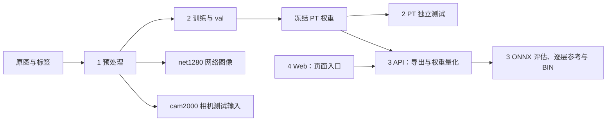

# H200 训练、测试、推理与量化运行环境

> 文档编排：2026-10-19；运行环境证据截至 10-16，源码工作区证据截至 10-18。本次未重新访问服务器。面向第一次接手项目的工程师。
> 训练/PT 推理已通过完整 Dockerfile 重建为日期镜像，完成 1280 单通道 GPU 训练、验证和 CPU/GPU 推理烟测。构建依赖与恢复说明已有源码提交；NAS 归档和清理结果见下文。未重启 API/Web，也未执行整套平台 clean-room 恢复。

> 当前环境恢复采用 2026-10-16 四类镜像统一备份。先按 [NAS 备份与环境恢复第 6.4 节](01_NAS备份与环境恢复.md#64-按-1016-版恢复-docker-镜像) 校验总清单、资产清单并导入指定镜像，再恢复对应源码和部署挂载。下文训练原烟测属于已有证据，本次文档更新未重新执行现场验证。

本文维护运行环境、依赖、构建条件与最近服务就绪记录。归档资产身份由 04 维护；最新源码由 REPOSITORIES 维护，完整职责见[来源表](SOURCES.md)。下文“本次”构建、烟测或导入均指原记录中的 10.16 操作，不是本轮文档整理执行。

## 1. 需要哪些环境

Docker 镜像是软件及依赖的打包模板，容器是其运行实例；Git 提交固定源码版本，两者需要匹配。项目使用 Linux x86_64 Docker 环境，Windows 工作站用于 SSH 控制和资料管理。H200 上的已验证组合为 Docker 29.1.3、NVIDIA 驱动 580.82.07、NVIDIA Container Toolkit 1.17.8-1；其他 PC 的兼容性需另行验证。

这里有四类运行环境，流程图编号与下表一致。同一个镜像可以承担多个阶段，不需要为训练和 PT 推理各准备一套依赖。



| 编号 | 用途 | 镜像名称 | tag | ID 前缀 / 大小约 |
|---|---|---|---|---|
| 1 | 数据筛选和预处理，CPU | `ywang/yolo-gray1-data-pipeline` | `0.2.1` | `ae238a8a9099` / 355 MB |
| 2 | 训练、val、PT 独立推理与可视化 | `yolo-gray1` | `1280-train-predict-20261016` | `79b0086e39b8` / 11.28 GB |
| 3 | PT/ONNX 评估、量化、软件回环、逐层导出和 BIN | `quantitize-platform-api` | `latest` | `f633b01c2f85` / 11.56 GB |
| 4 | 网页与 BFF，CPU；离线评估可不用 | `quantitize-platform-web` | `latest` | `7aef48747d3f` / 185 MB |

net1280 是网络输入，cam2000 是相机协议输入，不能互换；具体像素、字节布局及生成关系只在[数据与输入预处理](../class-21/knowledge/02_21类目标数据与输入预处理.md)维护。训练及 PT GPU 推理需要单独分配资源；API 各阶段按任务选择 CPU/GPU。

**当前打包方式**：使用普通 `docker/Dockerfile`，从 Ubuntu 22.04、离线运行时和完整 Gray1 源码构建，不依赖旧训练 v1 镜像。训练 Compose 与训练烟测脚本默认使用日期镜像。2026-10-16 已完成 8 张训练图、4 张验证图、batch=2、1 epoch 的 GPU 烟测，保存 checkpoint 并通过 CPU/GPU 单图推理；这不是模型精度验收。历史 v2 曾是 Predictor 修正版的别名，已由新镜像取代；旧标签清理记录与备份身份见第 2.2 节及平台 01。

恢复基线的四个完整镜像 ID 在[01 第 2 节](01_NAS备份与环境恢复.md#2-必须保护的身份)统一记录；上表保留运行职责、标签和身份前缀作为摘要，不另维护完整归档身份表。

标签不是不可变身份，每次任务都应记录完整 ID。本次完整重建的是训练/PT 镜像；API/Web 镜像和运行中的服务未改变。当前保留的项目运行环境为表中四个具名镜像，不能按镜像大小简单相加估算磁盘占用。

## 2. 源码、Dockerfile 和数据从哪里取

### 2.1 区分最新源码、运行源码与恢复快照

main 是开发主分支，运行工作区是服务实际读取的源码目录，恢复快照是备份时固定的源码集合。三者不能互换。

10.18 最新 main 与原运行目录仍不同，提交与路径只在[REPOSITORIES](../agent/topics/REPOSITORIES.md)维护。本页不重复提交表。10.16 镜像所配套的源码属于归档身份，由[01 第 2 节](01_NAS备份与环境恢复.md#2-必须保护的身份)及原资产 source-state 记录维护；API/Web 宿主提交不能自动当作镜像构建提交。

从有权限的仓库或已验证 bundle 获取固定源码，构建文件路径见第 4 节。未跟踪材料与凭据不因源码快照存在就视为已覆盖。

### 2.2 NAS 提供大文件和备份

NAS 保存镜像与独立模型、数据、结果归档。10.16 的恢复基线仍沿用已记录的四类镜像集合；具体目录、完整镜像 ID、归档哈希、资产覆盖和后增内容只在[01](01_NAS备份与环境恢复.md)维护。实际挂载入口与来源查[HOSTS](../agent/topics/HOSTS.md)，使用前现场复核。

本地 [task-artifacts](../../task-artifacts/README.md) 是部分构建证据，其原发布清单与本地内容不完全匹配，不能据此代替完整恢复包。版本差异和待核对事项见[OPEN_QUESTIONS](OPEN_QUESTIONS.md)。

## 3. 恢复 H200 环境的方法

本节只区分恢复路径，不另维护镜像导入命令或资产哈希。完整恢复从 [rebuild](../../rebuild/README.md)开始；现有服务异常先走[日常运维](../operations/README.md)。

### 3.1 导入镜像：优先取得当前版本的归档

先按[01 第 6.4 节](01_NAS备份与环境恢复.md#64-按-1016-版恢复-docker-镜像)核对集合与资产清单，再向已授权的独立目标导入。docker load 恢复镜像，不恢复宿主挂载内容；不得以 docker import 替代镜像归档恢复。

### 3.2 恢复数据、模型和部署文件

数据与模型从独立归档恢复到新目录；资产校验与发布步骤见[01 第 6 节](01_NAS备份与环境恢复.md#6-校验与恢复)。模型身份查[MODEL_BASELINE](../agent/topics/MODEL_BASELINE.md)，数据语义查[知识库 02](../class-21/knowledge/02_21类目标数据与输入预处理.md)。

恢复匹配的 Compose 和安全配置，再按目标机器调整路径、端口和资源。API 依赖宿主 apps/api、pipeline、shared_data、output_data 和 scratch；Web 挂载 apps/web。旧 input_symlinks.tar 仅保存链接，不包含图片。凭据通过独立安全渠道恢复，不写入文档。

## 4. 从 Dockerfile 构建时要带哪些材料

| 环境 | 必备文件与依赖 | 当前限制 |
|---|---|---|
| 预处理 | 固定源码 commit、`docker/Dockerfile`、带包哈希的 `docker/requirements.lock.txt`、基础镜像摘要 | 可按源码构建，新环境需验证输出像素与标签 |
| 训练与 PT 推理 | 发布提交的 `docker/Dockerfile`、`.dockerignore`、`docker/yolo-runtime.tar.gz` 与校验文件、完整 `src/Yolo_fine/`、`ubuntu:22.04` 基础镜像 | 运行时包从当前 NAS 根目录取得后放到仓库 `docker/`；完整构建不需要旧 v1 或三通道预训练权重 |
| API | `deploy/Dockerfile.api`、apps/api、pipeline、patches 及依赖环境 | FROM 的 `ywang/yolo-gray1-quant:ultralytics-8.3.98-v6` 具名标签缺失，构建链未固化；不能直接照抄重建当前镜像 |
| Web | `deploy/Dockerfile.web`、apps/web/requirements.txt 和源码 | 有构建定义，基础标签/部分依赖范围未完全锁定，不保证镜像字节相同 |

训练/PT 当前只推荐完整重建，使用新候选标签，验收后再决定正式命名：

```bash
docker build --network=none --pull=false -f docker/Dockerfile \
  -t yolo-gray1:1280-train-predict-candidate .
```

离线运行时包按[01 第 3.3 节](01_NAS备份与环境恢复.md#33-2026-10-16-完整训练pt-推理镜像)中的身份校验，并通过 `gzip -t`；不能用 requirements 文件代替它。构建时 Ubuntu 基础镜像 ID 为 `sha256:714d1a2f39e9830a7c0453dc924ddf849be74811c13e4afaa21c0b9b6ad74af0`，当前 Dockerfile 使用可变标签，重建不保证字节级相同。`Dockerfile.predictor-gray1` 仅保留为历史定义，清理旧 v1 后不能直接重放。完整步骤见远端打包说明及 NAS `BUILD_IMAGE.md`。

### 4.1 灰度图适配必须一起保留

模型专属的输入、训练、推理和导出适配由[知识库 03 第 7 节](../class-21/knowledge/03_训练评估量化与FPGA流程.md#7-gray1-源码适配与构建回归)维护；环境构建必须包含匹配源码及其补丁，但平台文档不再复制模型接口表。

### 4.2 YOLO 版本必须与依赖、补丁匹配

本项目使用**本地修改过的 Ultralytics 8.3.98 源码**，不是仅安装同版本 pip 包。通过 `/opt/ywang/yolo-runtime/bin/python` 和 `PYTHONPATH=/workspace/src/Yolo_fine/ultralytics` 选择实际实现。

| 依赖或文件 | 已验证组合及打包要求 |
|---|---|
| Python / PyTorch / torchvision | 3.12.12 / 2.8.0+cu128 / 0.23.0+cu128，按组合保留；GPU 还要匹配宿主驱动和容器工具包 |
| 图像与数值依赖 | NumPy 1.26.4、cv2 4.11.0、Albumentations 2.0.8、Pillow 12.2.0、PyYAML 6.0.3、tqdm 4.67.3 |
| 训练依赖记录 | 训练仓库 docker/requirements.lock.txt、docs/agent/runtime-packages-ultralytics-8.3.98-v1.json 与 Dockerfile 断言；前者是直接依赖记录，不是完整可重装锁文件 |
| ONNX / ONNX Runtime | API 环境为 1.17.0 / 1.24.3；按任务选择 provider，不因主机有 GPU 就自动用 CUDA |
| ORT 本地补丁 | patches/onnxruntime/quantization/quant_utils.py、operators/conv.py，配套 pipeline/engine/_load_local_onnxruntime_modules.py；子模块、QDQ 注册表和辅助函数绑定均须生效 |
| 服务依赖 | apps/api/requirements.txt、apps/web/requirements.txt；当前 FastAPI 0.128.8、Uvicorn 0.39.0，Web Python 3.11.16；这些 requirements 不包含完整算法环境 |

API 的 pip 元数据报 Ultralytics 8.4.21，但实际导入本地源码为 8.3.98，应同时检查版本和 `__file__`，不要用 `pip install -U ultralytics`“修正”表面差异。训练锁文件同时列了两个提供 cv2 的 OpenCV 发行包，这是快照历史状态，不是新环境重复安装的建议。

保留两项历史约束即可：训练采用离线运行时是因为当时包仓库不可用；9 月 20 日通过 ORT 补丁恢复 weight-only（权重 INT8、激活 FP16）精度。不能只按 `activation_type=QInt16` 参数判断最终图，仍须检查 148 个权重 DQ、无激活 QDQ，BIN 解析器也要与图结构匹配。

## 5. 恢复后如何确认能用

环境就绪后，从以下入口开始。命令参数、模型和数据清单以对应实验报告为准，避免在已发布目录覆盖运行：

| 工作 | 入口 |
|---|---|
| 预处理 | 预处理镜像 `python -m grayprep.cli`，仓库 `docker/compose.yaml` |
| 训练烟测 | 训练仓库 `run-gray1-training-smoke.sh <GPU_UUID> <dataset> [run_id]`，仅 1 epoch；基础训练 Compose 不申请 GPU |
| PT 独立测试 | 日期镜像内的本地 `ultralytics.YOLO.predict`，显式提供灰度输入、模型权重和 device；[run_pose21_stage4.py](../../tools/run_pose21_stage4.py) 是旧批次冻结脚本，含旧标签和叠加层检查，不能直接用于新镜像 |
| ONNX 测试 / 平台任务 | [eval_pose21_onnx500.py](../../tools/eval_pose21_onnx500.py)，或恢复 Compose 后从 Web 创建任务；新机器先确认资源与路径 |

1. 核对镜像完整 ID、实际源码/补丁哈希、解释器和模块路径；确认获取的是当前环境，而不是同名旧归档。
2. 固定一张 Gray1 图检查像素、首层和 batch 通道数；Predictor warmup 为 `[1,1,1280,1280]`，stride 为 8/16/32/64，ONNX shape/dtype 正确。
3. 运行同图 PT/ONNX、量化结构和 BIN 布局/哈希回归；业务阈值在测试前固定。CPU 单图 smoke 不能代替完整精度验收。
4. 部署后检查 API/Web health、API ready、历史任务查询；GPU 测试先按 [RUNBOOK](../agent/RUNBOOK.md) 检查持续采样、显存、进程 owner 和授权。

训练/PT 日期镜像已完成 GPU 训练烟测和 CPU/GPU 推理，实际训练输入 `[2,1,1280,1280]`，推理和 warmup 均为 `[1,1,1280,1280]`；GPU 峰值分配 7,577,967,104 bytes。Ultralytics 的速度摘要仍显示硬编码三通道形状，不能以这行日志否定实际张量 hook 的单通道证据。烟测从随机初始化训练一轮，不产出可用于业务的精度模型。

本次清理前另观察到 API `/ready` 为 HTTP 503，具体为容器内 `Failed to initialize NVML: Unknown Error`；API/Web `/health` 均 HTTP 200，宿主 GPU 查询正常，新训练镜像 GPU 烟测通过。未重启或修复该 API 容器，不能据健康检查通过宣称量化 GPU readiness 正常；记录见 NAS `records/smoke/service-checks.json`。

整套恢复目前仍是 `PARTIAL`：当前四类镜像与受跟踪源码已归档，但完整离线构建材料和新主机整套隔离恢复仍未闭环。此次新增预处理、API/Web 归档完成配置/层哈希和 NAS 回读验证，未执行导入或业务推理回归。软件回环、逐层参考和 cam2000 数据生成不能代表 FPGA 实机验收通过。数据准备、实验结果和逐层细节分别见[知识库 02](../class-21/knowledge/02_21类目标数据与输入预处理.md)、[当前报告](../class-21/reports/current/README.md)和[知识库 03](../class-21/knowledge/03_训练评估量化与FPGA流程.md)。
